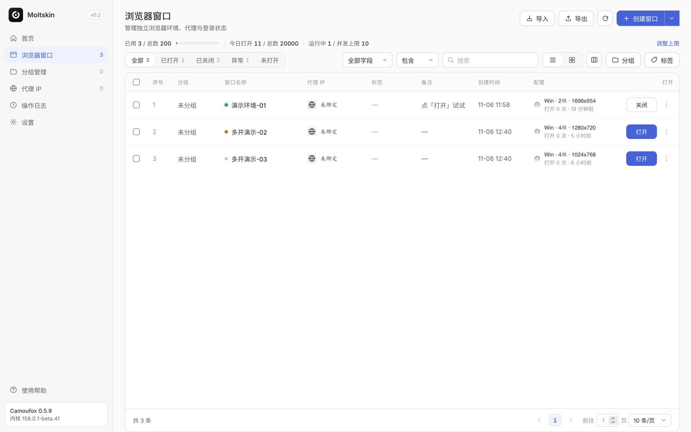
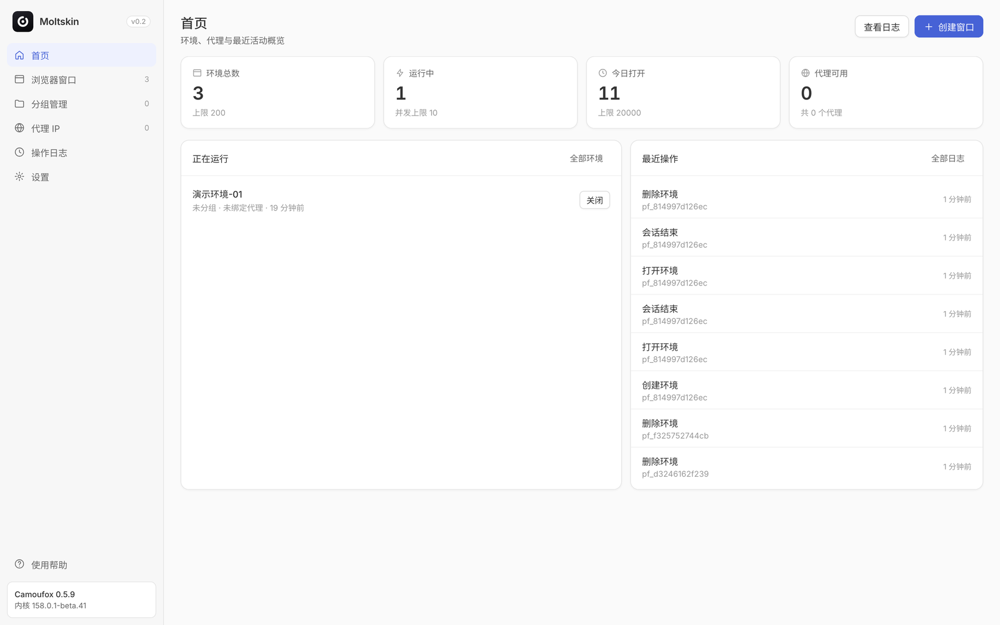

# Moltskin

<p align="center"></p>

**Self-hosted multi-profile browser with stable fingerprints, proxies, and a local API.**

Moltskin is an open-source, local-first alternative to commercial anti-detect browsers.
It manages isolated browser profiles on top of [Camoufox](https://github.com/daijro/camoufox)
and exposes them through a web UI and a local REST API.

[中文文档](README.zh-CN.md)



| Dashboard | Create | Batch create |
|---|---|---|
|  |  |  |

> Status: **v0.2.0 alpha**. The core create → launch → reuse loop works; expect breaking changes. [Changelog](CHANGELOG.md)

---

## Why Moltskin

- **Local-first** — profiles, cookies and logs stay on your machine. No cloud account.
- **Stable identity** — each profile gets one fingerprint preset at creation and keeps it across launches.
- **Isolated by default** — one browser process and one `user_data_dir` per profile.
- **Auditable kernel** — built on Camoufox, an open-source Firefox fork with C++-level fingerprint patches.
- **API-first** — manage profiles, proxies and sessions over HTTP; MCP support is on the roadmap.

## Features

| Area | Status |
|---|---|
| Create / edit / duplicate / delete profiles | ✅ |
| Launch / stop, persistent cookies and logins | ✅ |
| One process per profile, duplicate-launch protection | ✅ |
| Fingerprint preset persisted per profile | ✅ |
| Fingerprint preview (UA, screen, WebGL, cores) | ✅ |
| Pre-launch consistency checks | ✅ |
| CreepJS self-test with screenshot | ✅ |
| Proxy pool with exit IP / country / timezone / latency check | ✅ |
| GeoIP alignment (timezone, locale, coordinates) | ✅ |
| Local API with bearer token | ✅ |
| Manager UI: dashboard, window list, groups, proxies, logs, settings | ✅ |
| Sortable columns, pagination, column visibility, table/card views | ✅ |
| Keyword search with field + operator, group/tag filters | ✅ |
| Batch open/stop/delete/move/tag/export, batch create | ✅ |
| Manager page opened inside the browser on launch | ✅ |
| Orphan browser cleanup on startup | ✅ |
| Scheduled proxy health checks | ✅ |
| Groups, tags, JSON import/export | ✅ |
| MCP server, Python SDK | ✅ |
| Desktop app | 🚧 |

### Manager page inside the browser

When a profile launches, Moltskin opens the manager as the first tab, so the same
window can create or switch profiles without leaving the browser.


## Quick start

### Docker (recommended)

```bash
git clone https://github.com/yushui2022/Moltskin.git
cd Moltskin
docker compose up -d
```

Open <http://127.0.0.1:8765>.

The first build downloads the Camoufox browser (~1.3 GB) and takes several minutes.
The resulting image is large (several GB) because it bundles the browser.
Profiles and the SQLite database are stored in `./data`.

### Local (macOS / Linux)

Requirements: Python 3.10+, [uv](https://github.com/astral-sh/uv), and macOS or Linux.

```bash
git clone https://github.com/yushui2022/Moltskin.git
cd Moltskin

uv venv .venv --python 3.12
uv pip install --python .venv/bin/python -r requirements.txt
.venv/bin/camoufox fetch

.venv/bin/python run.py
```

Then open <http://127.0.0.1:8765>.

## How it works

```text
┌─────────────────────────────────────────────┐
│  Web UI (React-free, plain HTML/CSS/JS)     │
└──────────────────┬──────────────────────────┘
                   │ HTTP + token
┌──────────────────▼──────────────────────────┐
│  FastAPI service                            │
│  profiles · proxies · launcher · sessions   │
│  SQLite                                     │
└──────────────────┬──────────────────────────┘
                   │ subprocess per profile
┌──────────────────▼──────────────────────────┐
│  Runner (Python)                            │
│  Camoufox(persistent_context=True, ...)     │
└──────────────────┬──────────────────────────┘
                   │
              Firefox / Camoufox
```

- Each profile has its own `user_data_dir`; Firefox locks it, so a profile cannot run twice.
- The fingerprint preset is generated once at profile creation and stored in SQLite.
  Every launch passes the same preset to Camoufox.
- Proxy checks and GeoIP lookups use Camoufox's own components
  (`camoufox.ip`, `camoufox.geolocation`).

## Tests

```bash
pip install -r requirements-dev.txt
pytest -q tests/test_smoke.py
```

The smoke tests use a temporary data directory and do not launch a browser.
The full integration test is `tests/test_m0.py`.

## API

Base URL: `http://127.0.0.1:8765/api/v1`

The token is generated at first start and stored in `data/api.token`.

```bash
TOKEN=$(cat data/api.token)

curl -H "Authorization: Bearer $TOKEN" \
  http://127.0.0.1:8765/api/v1/profiles
```

| Method | Endpoint | Description |
|---|---|---|
| GET | `/profiles` | List profiles |
| POST | `/profiles` | Create a profile |
| POST | `/profiles/{id}/launch` | Launch |
| POST | `/profiles/{id}/stop` | Stop |
| GET | `/profiles/{id}/status` | Status |
| GET/POST | `/proxies` | Proxy pool |
| POST | `/proxies/{id}/check` | Check exit IP / geo |
| POST | `/profiles/{id}/verify` | Fingerprint / proxy consistency checks |
| POST | `/profiles/{id}/self-test` | Open CreepJS, screenshot, save report |
| POST | `/profiles/batch` | Batch launch / stop / delete / move / tag |
| GET | `/export/profiles` | Export profiles as JSON |
| POST | `/import/profiles` | Import profiles from JSON |
| GET/PUT | `/settings` | Settings |
| GET | `/engine` | Camoufox version and installed builds |

Interactive docs: <http://127.0.0.1:8765/docs>
Full endpoint reference: [docs/API.md](docs/API.md)

## MCP server

Start Moltskin, then add this to Claude Desktop, Cursor or any MCP client:

```json
{
  "mcpServers": {
    "moltskin": {
      "command": "/path/to/Moltskin/.venv/bin/python",
      "args": ["/path/to/Moltskin/moltskin/services/core/mcp_server.py"],
      "env": { "MOLTSKIN_API": "http://127.0.0.1:8765" }
    }
  }
}
```

The server exposes 15 tools: create/list/launch/stop profiles, proxies, groups,
consistency checks, self-test and batch operations.

## Python SDK

```python
from moltskin.client import MoltskinClient

with MoltskinClient() as client:
    profile = client.create_profile("shop-ph-01", proxy_id="px_...")
    client.launch(profile["id"])
    print(client.status(profile["id"]))
    client.stop(profile["id"])
```

## Configuration

| Variable | Default | Description |
|---|---|---|
| `MOLTSKIN_DATA_DIR` | `data` | Data directory |
| `MOLTSKIN_HOST` | `127.0.0.1` | Bind host |
| `MOLTSKIN_PORT` | `8765` | Service port |
| `MOLTSKIN_HEADLESS` | unset | Force headless mode (Docker sets `1`) |
| `MOLTSKIN_OPEN_MANAGER` | `1` | Open the manager page on launch |

## Roadmap

- **v0.1** — profile CRUD, launch/stop, proxies, API, web UI
- **v0.2** — fingerprint preview, consistency check, groups/tags, batch create/open, import/export
- **v0.3** — MCP server, Python SDK, webhooks
- **v0.4** — desktop app (Tauri), auto-update
- **v1.0** — stable API, team features, distributed runners

## Comparison

| | Moltskin | BitBrowser | AdsPower | Multilogin |
|---|---|---|---|---|
| Open source | ✅ | ❌ | ❌ | ❌ |
| Self-hosted / local data | ✅ | ❌ | ❌ | ❌ |
| Browser kernel | Camoufox (Firefox) | Chromium + Firefox | Multi | Custom |
| Stable fingerprint per profile | ✅ | ✅ | ✅ | ✅ |
| Team & permissions | 🚧 | ✅ | ✅ | ✅ |
| MCP / AI agents | 🚧 | ✅ (7.1.5+) | Beta | Bridge |
| Price | Free | Freemium | Freemium | Paid |

## Disclaimer

Moltskin is a browser profile management tool. It is intended for legitimate
testing, privacy, scraping your own data, and multi-account operations that
comply with the target platform's terms and applicable law.

It does not provide, and must not be used for, bulk account registration,
identity fraud, captcha farming, or bypassing platform KYC. Fingerprint
detection is an ongoing arms race; no tool can guarantee 100% undetectability.

## Credits

The interface design language is inspired by [Twenty](https://github.com/twentyhq/twenty).
Only visual tokens and layout patterns were reimplemented for this project; no
Twenty source code is included.

## License

Moltskin is licensed under the Apache License 2.0. See [LICENSE](LICENSE).

Camoufox is a separate project licensed under MPL-2.0. See [NOTICE](NOTICE).
The bundled Noto Sans SC font is licensed under SIL OFL 1.1
(`web/fonts/OFL.txt`).
