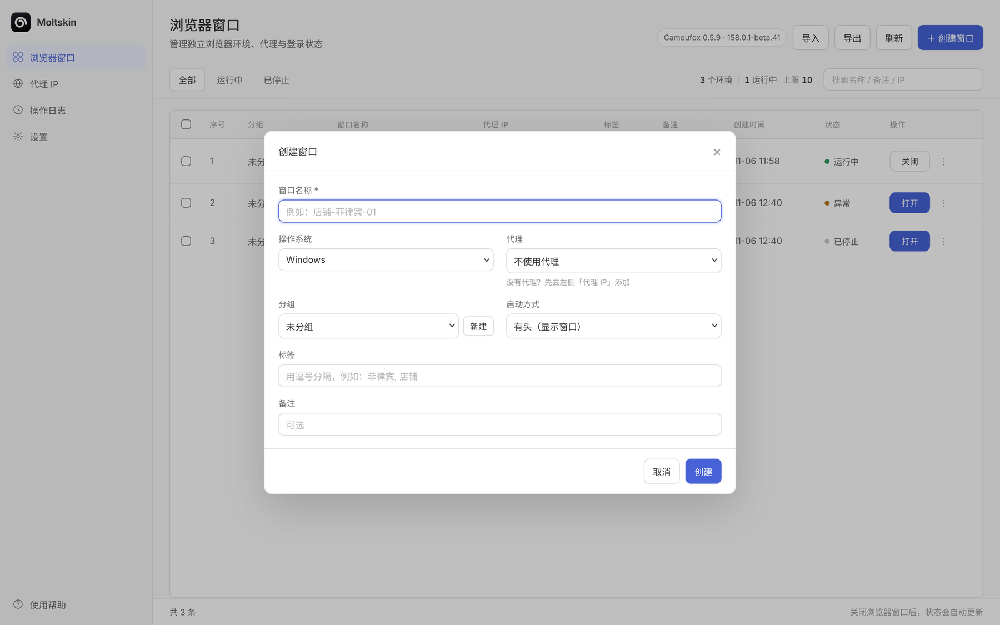
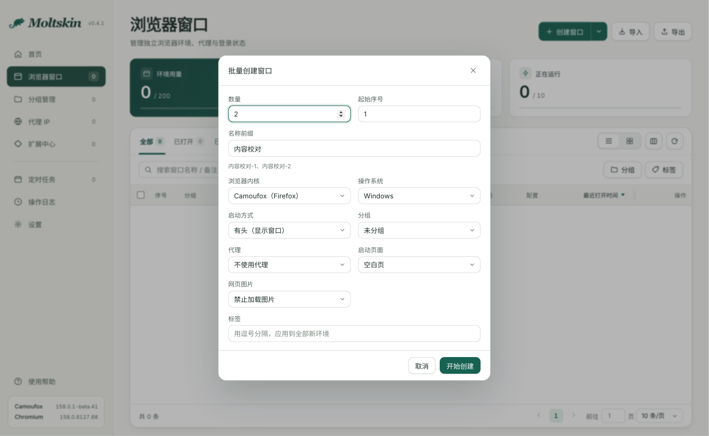
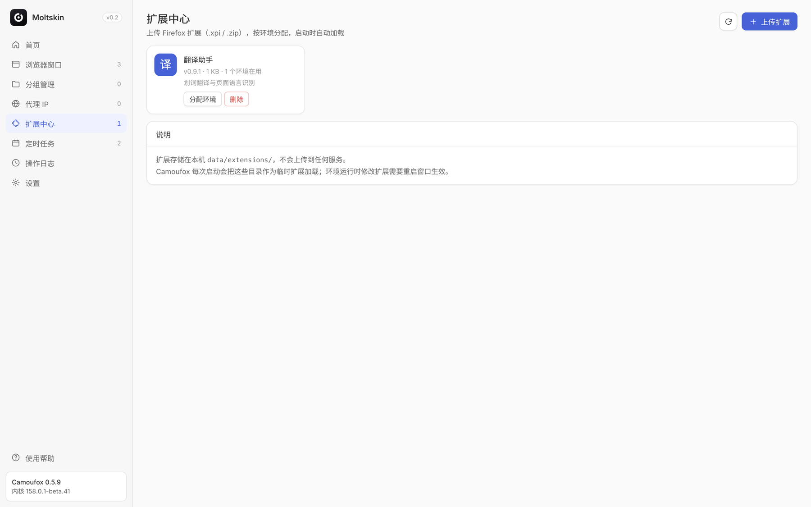
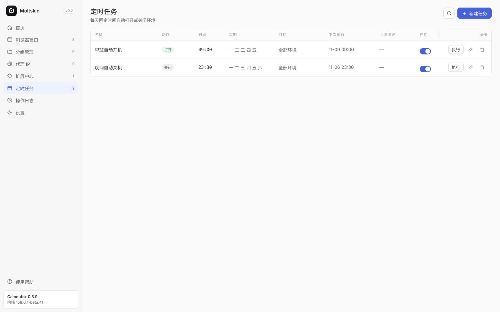
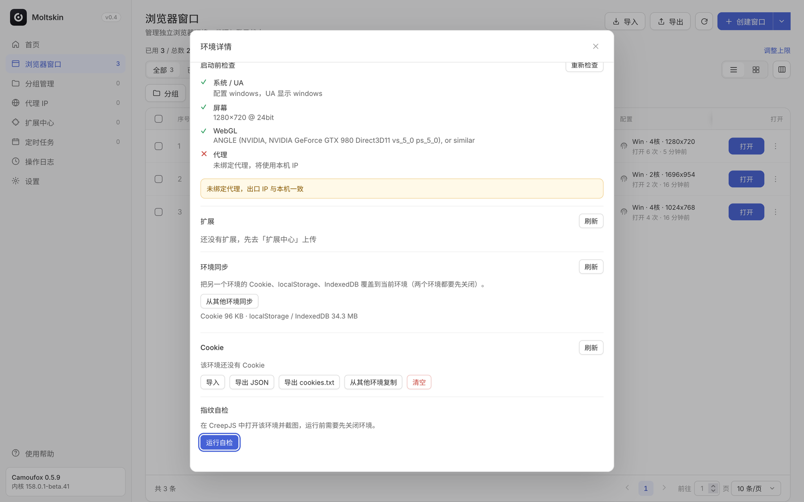
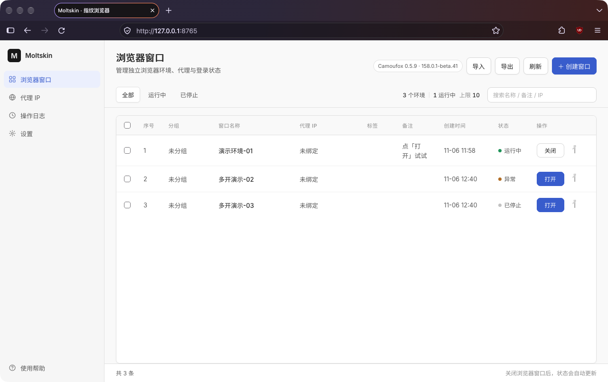

# Moltskin

<p align="center"></p>

[中文文档](README.zh-CN.md)

Moltskin is a self-hosted browser for managing isolated profiles. In the **0.4.1 alpha**, each profile has its own data directory, fingerprint preset and proxy settings. The local dashboard and REST API launch [Camoufox (Firefox)](https://github.com/daijro/camoufox). [Changelog](CHANGELOG.md) · [Quick start](#quick-start)

## Chromium roadmap

Open Moltskin to manage profiles in a Chromium tab. The `chrome://moltskin/` shortcut opens the local dashboard. Select Camoufox or Chromium when creating a profile. Chromium profiles also have a local font access setting. Each profile keeps its engine and data directory across restarts. The Chromium build has been verified on Apple Silicon. Linux x86-64 browser verification is pending. [Build and run the Chromium preview](chromium/README.md)

| Milestone | What we will verify |
|---|---|
| Build the engine | Build a pinned Chromium revision on Linux x86-64 and macOS arm64. Launch each build from a clean profile and record its version and checksum. |
| Launch both engines | Choose the engine for each new profile in the dashboard. Existing Camoufox profiles keep their data. Separate Chromium profiles can run and restart independently. |
| Ship a native privacy setting | Start with local font enumeration. A test page must observe the restriction in profile A while profile B retains its own permission. Extend coverage to graphics, media devices and locale as tests land. |
| Migrate profiles and run them remotely | Import a separate Hubstudio cookie file into each of two Chromium profiles. Verify both accounts on the same test site after restart. On a Linux node, check that each authorized user sees and controls only their own session. |
| Maintain releases | Track upstream Beta and Stable, apply our patches on upgrade branches, build both platforms and test profile upgrades and recovery before publishing. |

**Planned GitHub automation.** When someone reports a bug, the bot will ask for missing details or reproduce it and open a draft fix with a regression test. On new or updated pull requests, it will report the tested commit, what failed before the change and what passed afterward. Maintainers review and merge. [Contributing](CONTRIBUTING.md)


| Dashboard | Create | Batch create |
|---|---|---|
|  |  |  |

| Extensions | Schedules | Profile detail |
|---|---|---|
|  |  |  |

## Why Moltskin

- **Local-first** — profiles, cookies and logs stay on your machine. No cloud account.
- **Stable identity** — each profile gets one fingerprint preset at creation and keeps it across launches.
- **Isolated by default** — one browser process and one `user_data_dir` per profile.
- **Auditable kernel** — built on Camoufox, an open-source Firefox fork with C++-level fingerprint patches.
- **API-first** — manage profiles, proxies and sessions over HTTP, through the Python SDK or with the MCP server.

## Features

| Area | Status |
|---|---|
| Create, edit and duplicate profiles. Restore individual profiles from the recycle bin or permanently delete their local data. | ✅ |
| Launch / stop, persistent cookies and logins | ✅ |
| One process per profile, duplicate-launch protection | ✅ |
| Fingerprint preset persisted per profile | ✅ |
| Fingerprint preview (UA, screen, WebGL, cores) | ✅ |
| Camoufox preset and browser readings compared on launch, with separate configuration and proxy checks | ✅ |
| CreepJS self-test with screenshot | ✅ |
| Proxy pool with exit IP / country / timezone / latency check | ✅ |
| GeoIP alignment (timezone, locale, coordinates) | ✅ |
| Local API with bearer token | ✅ |
| Manager UI: dashboard, window list, groups, proxies, logs, settings | ✅ |
| Sortable columns, pagination, column visibility, table/card views | ✅ |
| Keyword search with field + operator, group/tag filters | ✅ |
| Batch open/stop/delete/move/tag/export, batch create | ✅ |
| Manager page opened inside the browser on launch | ✅ |
| Orphan browser cleanup on startup | ✅ |
| Scheduled proxy health checks | ✅ |
| Groups, tags, JSON import/export | ✅ |
| Cookie import / export (JSON, Netscape), copy between profiles | ✅ |
| Extension center: upload, assign per profile, loaded on launch | ✅ |
| Batch open/stop with per-environment progress | ✅ |
| Scheduled launch / stop tasks (daily or every N minutes) | ✅ |
| In-browser console button (sidebar / toolbar / Alt+Shift+M) | ✅ |
| Environment sync: cookies + localStorage + IndexedDB | ✅ |
| Backup / restore (database, extensions, optional login state) | ✅ |
| MCP server, Python SDK | ✅ |
| Desktop app | 🚧 |

### Manager page inside the browser

Choose the local dashboard, a blank page, or the engine default when creating or
editing a profile. By default Chromium opens a blank tab and Camoufox follows the
dashboard's startup setting. Both engines can also block webpage images per
profile. Changes apply on the next launch and are included in profile exports.



## Quick start

### Docker (recommended)

```bash
git clone https://github.com/yushui2022/Moltskin.git
cd Moltskin
docker compose up -d
```

Open <http://127.0.0.1:8765>.

The first build downloads the Camoufox browser (~1.3 GB) and takes several minutes.
The resulting image is large (several GB) because it bundles the browser.
Profiles and the SQLite database are stored in `./data`.

### Local (macOS / Linux)

Requirements: Python 3.10+, [uv](https://github.com/astral-sh/uv), and macOS or Linux.

```bash
git clone https://github.com/yushui2022/Moltskin.git
cd Moltskin

uv venv .venv --python 3.12
uv pip install --python .venv/bin/python -r requirements.txt
.venv/bin/camoufox fetch

.venv/bin/python run.py
```

Then open <http://127.0.0.1:8765>.

## How it works

```text
┌─────────────────────────────────────────────┐
│  Web UI (React-free, plain HTML/CSS/JS)     │
└──────────────────┬──────────────────────────┘
                   │ HTTP + token
┌──────────────────▼──────────────────────────┐
│  FastAPI service                            │
│  profiles · proxies · launcher · sessions   │
│  SQLite                                     │
└──────────────────┬──────────────────────────┘
                   │ subprocess per profile
┌──────────────────▼──────────────────────────┐
│  Runner (Python)                            │
│  Camoufox(persistent_context=True, ...)     │
└──────────────────┬──────────────────────────┘
                   │
              Firefox / Camoufox
```

- Each profile has its own `user_data_dir`; Firefox locks it, so a profile cannot run twice.
- The fingerprint preset is generated once at profile creation and stored in SQLite.
  Every launch passes the same preset to Camoufox.
- Proxy checks and GeoIP lookups use Camoufox's own components
  (`camoufox.ip`, `camoufox.geolocation`).

## Tests

```bash
pip install -r requirements-dev.txt
pytest -q tests/test_smoke.py
```

The smoke tests use a temporary data directory and do not launch a browser.
The full integration test is `tests/test_m0.py`.

## API

Base URL: `http://127.0.0.1:8765/api/v1`

The token is generated at first start and stored in `data/api.token`.

```bash
TOKEN=$(cat data/api.token)

curl -H "Authorization: Bearer $TOKEN" \
  http://127.0.0.1:8765/api/v1/profiles
```

| Method | Endpoint | Description |
|---|---|---|
| GET | `/profiles` | List profiles |
| POST | `/profiles` | Create a profile |
| POST | `/profiles/{id}/launch` | Launch |
| POST | `/profiles/{id}/stop` | Stop |
| GET | `/profiles/{id}/status` | Status |
| GET/POST | `/proxies` | Proxy pool |
| POST | `/proxies/{id}/check` | Check exit IP / geo |
| POST | `/profiles/{id}/verify` | Fingerprint / proxy consistency checks |
| POST | `/profiles/{id}/self-test` | Open CreepJS, screenshot, save report |
| POST | `/profiles/batch` | Batch launch / stop / delete / move / tag |
| GET | `/export/profiles` | Export profiles as JSON |
| POST | `/export/profiles` | Export selected profile IDs in the same JSON format |
| POST | `/import/profiles` | Import profiles from JSON |
| GET/PUT | `/settings` | Settings |
| GET | `/engine` | Camoufox builds and local Moltskin Chromium availability |

Interactive docs: <http://127.0.0.1:8765/docs>
Full endpoint reference: [docs/API.md](docs/API.md)

## MCP server

Start Moltskin, then add this to Claude Desktop, Cursor or any MCP client:

```json
{
  "mcpServers": {
    "moltskin": {
      "command": "/path/to/Moltskin/.venv/bin/python",
      "args": ["/path/to/Moltskin/moltskin/services/core/mcp_server.py"],
      "env": { "MOLTSKIN_API": "http://127.0.0.1:8765" }
    }
  }
}
```

The server exposes 15 tools: create/list/launch/stop profiles, proxies, groups,
consistency checks, self-test and batch operations.

## Python SDK

```python
from moltskin.client import MoltskinClient

with MoltskinClient() as client:
    profile = client.create_profile("shop-ph-01", proxy_id="px_...")
    client.launch(profile["id"])
    print(client.status(profile["id"]))
    client.stop(profile["id"])
```

## Configuration

| Variable | Default | Description |
|---|---|---|
| `MOLTSKIN_DATA_DIR` | `data` | Data directory |
| `MOLTSKIN_HOST` | `127.0.0.1` | Bind host |
| `MOLTSKIN_PORT` | `8765` | Service port |
| `MOLTSKIN_HEADLESS` | unset | Force headless mode (Docker sets `1`) |
| `MOLTSKIN_OPEN_MANAGER` | `1` | Open the manager page on launch |

## Comparison

| | Moltskin | BitBrowser | AdsPower | Multilogin |
|---|---|---|---|---|
| Open source | ✅ | ❌ | ❌ | ❌ |
| Self-hosted / local data | ✅ | ❌ | ❌ | ❌ |
| Browser kernel | Camoufox (Firefox) | Chromium + Firefox | Multi | Custom |
| Stable fingerprint per profile | ✅ | ✅ | ✅ | ✅ |
| Team & permissions | 🚧 | ✅ | ✅ | ✅ |
| MCP / AI agents | 🚧 | ✅ (7.1.5+) | Beta | Bridge |
| Price | Free | Freemium | Freemium | Paid |

## Disclaimer

Moltskin is a browser profile management tool. It is intended for legitimate
testing, privacy, scraping your own data, and multi-account operations that
comply with the target platform's terms and applicable law.

It does not provide, and must not be used for, bulk account registration,
identity fraud, captcha farming, or bypassing platform KYC. Fingerprint
detection is an ongoing arms race; no tool can guarantee 100% undetectability.

## Credits

The interface design language is inspired by [Twenty](https://github.com/twentyhq/twenty).
Only visual tokens and layout patterns were reimplemented for this project; no
Twenty source code is included.

## Testing

```bash
pytest tests -q                       # unit / smoke
python tests/test_e2e.py              # full loop against a running service
python tests/test_edge.py             # input limits, quotas, error paths
python tests/test_runtime.py          # real browser identity, reaper, scheduler
```

## License

Moltskin is licensed under the Apache License 2.0 — see [LICENSE](LICENSE).
Commercial use, closed-source forks and redistribution are allowed.

It builds on Camoufox: the Python package is MIT, the patched Firefox browser
build is MPL-2.0. Moltskin runs both unmodified, so nothing in this repository
becomes MPL-covered. See [NOTICE](NOTICE) for the full third-party list, the
bundled Noto Sans SC / Inter fonts (SIL OFL 1.1) and what redistribution of the
browser binary requires.
